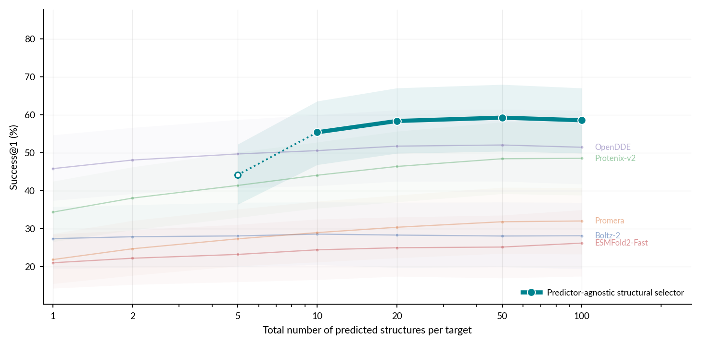

# AbPoolRank

Pick the best predicted antibody–antigen structure out of a pool of predictions from several co-folding
predictors, using pose geometry alone (no confidence scores, no predictor identity, no reference
structure).

On 103 cluster-disjoint, post-2021 antibody–antigen complexes from SAbDab2, three structures each from five
co-folding predictors (a 15-structure pool) ranked by AbPoolRank reach 58.0% medium-or-better Success@1
(DockQ ≥ 0.49). Confidence-based selection from any single predictor sampled 100 times reaches 26–52%.



## Install

Requires Python 3.11 or 3.12.

```bash
pip install git+https://github.com/VarunUllanat/abpoolrank.git
```

or, from a clone:

```bash
git clone https://github.com/VarunUllanat/abpoolrank.git
cd abpoolrank
pip install -e ".[dev]"
```

The trained selectors (~2.6 MB) ship with the package; nothing else needs to be downloaded. The co-folding
predictors are not dependencies: run them however you like and point AbPoolRank at their output structures.

## Run

Put each predictor's structures in its own subdirectory. The predictor names are arbitrary; they only tell the
selector which poses share an origin.

```
predictions/
  boltz2/        pose_0.cif  pose_1.cif  pose_2.cif
  protenix/      sample_00.cif  sample_01.cif  sample_02.cif
  my_new_model/  a.pdb  b.pdb  c.pdb
```

```bash
abpoolrank select predictions/ --workers 8 --csv ranking.csv
```

```python
from abpoolrank import PoolSelector

result = PoolSelector(workers=8).rank("predictions/")
print(result.best.path)
```

Options: `--model` (see below), `--antibody-chains` (default `H,L`; all other chains are the antigen),
`--max-per-source`, `--top`, `--csv`, `--checkpoint`. Accepts `.cif`, `.mmcif`, `.pdb`, `.ent`.

Use **at least two poses per predictor**; the manuscript's headline setting is three. With one, the
source-balanced feature reduces to plain pose-similarity support and the selector warns. Predictors do not
need to be ones the selector was trained on: it never sees predictor identities.

### Choosing a model

| `--model` / `model=` | Trained on | Use for |
|---|---|---|
| `both` (default) | paired antibodies and VHHs (608 complexes) | any antibody type; the selector reported in the manuscript |
| `paired-only` | paired heavy + light chain antibodies only (411) | paired antibodies |
| `vhh-only` | VHHs / nanobodies only (197) | VHHs |

```bash
abpoolrank select predictions/ --model vhh-only
```

```python
result = PoolSelector(model="paired-only").rank("predictions/")
```

To use your own checkpoint by default, set `$ABPOOLRANK_SELECTOR` to its path; a model named with `--model`
always takes precedence.

## Output

```
pool: 15 poses from 5 sources (boltz2=3, esmfold2_fast=3, opendde=3, promera=3, protenix_v2=3)

best: predictions/protenix_v2/pose_1.pdb
      source=protenix_v2  score=0.6811

top 5:
    1. +0.6811  protenix_v2        pose_1.pdb
    2. +0.6781  protenix_v2        pose_0.pdb
    ...
```

`result.best.path` is the structure to take forward. `result.table` (or `--csv`) gives the full ranking with
the four features behind each score:

| column | meaning |
|---|---|
| `rank`, `source`, `score`, `path` | position in the ranking, predictor subdirectory, selector score, structure file |
| `pss_pct` | within-pool percentile of the pose's geometric support from all other poses |
| `srcbal_pct` | within-pool percentile of support balanced across the other predictors |
| `epi_pct` | within-pool percentile of epitope agreement with the other poses |
| `log_pool` | log of the pool size |

## Tests

```bash
pytest
```

Tests that need the study's cached artifacts skip when those are absent. The API tests run on any
five-predictor, two-pose pool: `ABPOOLRANK_TEST_POOL=/path/to/pool pytest`.

## Citation

If you use AbPoolRank, please cite:

> Ullanat V, Gupta A, Li R, Amengual-Rigo P, Furtmann N, Bryson B, Berger B. Breadth over Depth:
> Predictor-Agnostic Consensus for Improved Antibody–Antigen Structure Prediction. *bioRxiv* (2026).

## License

MIT; see [LICENSE](LICENSE).
